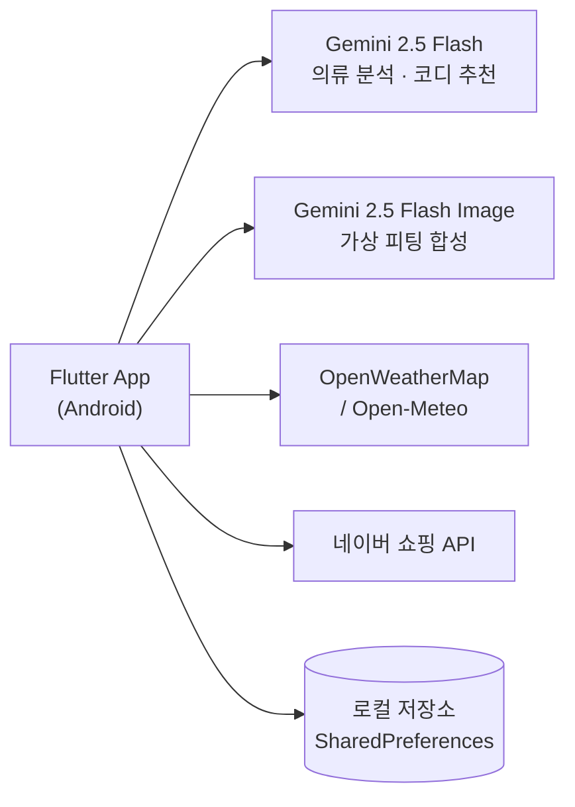

# MOIP-Z (모입지)

> **"오늘 뭐 입지?"** — 매일 아침의 그 질문에 답하는 AI 옷장 앱

내 옷장에 있는 옷으로, 오늘 날씨와 상황에 맞는 코디를 추천받고,
**내 사진에 직접 입혀본 뒤** 결정합니다.


---

## 시연 영상

**▶ [MOIP-Z 실행 영상 보기](https://www.youtube.com/shorts/bD1kWd607l0)**

---

## 스크린샷

| 홈 | 옷장 | 가상 피팅 | AI 코디 | 프로필 |
|:--:|:--:|:--:|:--:|:--:|
|  |  |  |  |  |

---

## 이 앱이 푸는 문제

옷은 많은데 입을 게 없다고 느끼는 이유는 옷이 부족해서가 아니라,
**내가 무엇을 가지고 있는지 기억하지 못하기 때문**입니다.

그래서 새 옷을 삽니다. 그리고 또 안 입습니다.

MOIP-Z는 세 단계로 이 고리를 끊습니다.

1. **기록한다** — 사진 한 장이면 AI가 카테고리·색상·종류·계절을 자동 분류
2. **추천한다** — 오늘 날씨와 상황, 내 체형과 선호에 맞춰 보유한 옷 중에서 조합
3. **확인한다** — 결정 전에 내 사진에 입혀본다

---

## 주요 기능

### 옷장 관리

옷 사진을 찍으면 Gemini가 분석해 카테고리(상의·하의·아우터·신발), 색상, 구체적 종류,
착용 계절을 자동으로 채웁니다. 직접 타이핑할 필요가 없습니다.

### AI 코디 추천

현재 위치의 실시간 날씨(기온·상태), 선택한 상황(출근·데이트·운동·캐주얼),
저장된 프로필(키·체형·선호 스타일·피부톤)을 종합해
자켓 → 상의 → 하의 → 신발 → 액세서리 순으로 코디를 제안합니다.

**보유한 옷을 우선적으로 고르고**, 마땅한 것이 없는 항목만 새 아이템을 제안합니다.
각 항목마다 그렇게 고른 이유가 한 줄로 붙습니다.

같은 조합이 반복되지 않도록, "다른 코디 추천받기"는 직전 결과를 프롬프트에 넣어
제외하도록 지시하고 temperature를 함께 올립니다.

### 가상 피팅

전신 사진 한 장과 옷장에서 고른 옷들을 Gemini 2.5 Flash Image에 함께 전달해
착용 모습을 합성합니다.

얼굴이 다른 사람으로 바뀌는 것이 이 기능의 가장 큰 실패 모드입니다.
정체성 보존을 한국어와 영어로 병기해 강하게 지시하는 방식으로 대응했습니다.
결과는 피팅 기록에 저장되어 나중에 다시 볼 수 있습니다.

### 홈

위치 기반 날씨와, 그 날씨·성별에 맞는 상품 추천을 네이버 쇼핑에서 가져와 보여줍니다.

---

## 차별점

가상 피팅 기술 자체는 이미 여러 곳에 있습니다. 다만 대부분 **브랜드를 위한 도구**입니다.
쇼핑몰이 모델 촬영 없이 상품 이미지를 만드는 용도이고, 사용자는 결과물을 볼 뿐입니다.

MOIP-Z는 방향이 반대입니다.

|  | 기존 가상 피팅 서비스 | MOIP-Z |
|---|---|---|
| 사용자 | 브랜드·쇼핑몰 | 개인 |
| 입력 사진 | 표준 체형 모델 | **본인 전신 사진** |
| 옷 | 판매할 신상품 | **이미 가진 옷** |
| 목적 | 상품 콘텐츠 제작 | **오늘 뭘 입을지 결정** |

모델이 입은 모습이 아니라 **내가 입은 모습**을 보는 것.
이것이 이 앱의 존재 이유입니다.

---

## 기술 스택

| 영역 | 기술 |
|---|---|
| 프레임워크 | Flutter 3.5 / Dart 3.5 |
| AI | Google Gemini 2.5 Flash (텍스트·이미지 분석) |
| 이미지 생성 | Gemini 2.5 Flash Image (가상 피팅 합성) |
| 날씨 | OpenWeatherMap (주) / Open-Meteo (폴백) |
| 커머스 | 네이버 쇼핑 검색 API |
| 위치 | geolocator, geocoding |
| 로컬 저장 | shared_preferences, path_provider |
| 이미지 | image_picker |

---

## 시스템 구성



현재는 앱이 외부 API를 직접 호출하는 구조입니다.
API 키를 서버로 옮기는 백엔드 분리 작업이 로드맵에 있습니다. (아래 참조)

---

## 시작하기

### 요구 사항

- Flutter SDK 3.5 이상
- Android SDK (minSdk 21)
- Google AI Studio API 키

### 설치

```cmd
git clone https://github.com/smj1746/MOIPZ-flutter.git
cd MOIPZ-flutter\client
flutter pub get
```

### API 키 설정

**이 단계를 건너뛰면 컴파일되지 않습니다.** 키 파일 두 개를 만들어야 합니다. (아래 경로는 모두 `client\` 기준입니다.)

**1) `lib/secrets.dart`**

```cmd
copy lib\secrets.example.dart lib\secrets.dart
```

```dart
class Secrets {
  static const String geminiApiKey = '발급받은_Gemini_API_키';
}
```

Gemini 키는 [Google AI Studio](https://aistudio.google.com/apikey)에서 무료로 발급받습니다.

**2) `lib/screens/secrets.dart`**

```cmd
copy lib\screens\secrets.example.dart lib\screens\secrets.dart
```

```dart
const String naverClientId = '네이버_클라이언트_ID';
const String naverClientSecret = '네이버_클라이언트_시크릿';
const String owmApiKey = 'OpenWeatherMap_API_키';
```

네이버와 OpenWeatherMap 키는 **선택 사항**입니다.
비워두면 상품은 더미 데이터로, 날씨는 키가 필요 없는 Open-Meteo로 자동 대체됩니다.

- 네이버: [네이버 개발자 센터](https://developers.naver.com/apps)
- 날씨: [OpenWeatherMap](https://openweathermap.org/api)

두 파일 모두 `.gitignore`에 등록되어 있어 커밋되지 않습니다.

### 실행

```cmd
cd client
flutter devices
flutter run
```

기기를 지정하려면:

```cmd
flutter run -d <device-id>
```

### 빌드

```cmd
cd client
flutter build apk --release
```

산출물: `client\build\app\outputs\flutter-apk\app-release.apk`

---

## 프로젝트 구조

모노레포 구조로 client(Flutter)와 server(Node.js)를 분리했습니다.

```
MOIPZ-flutter/
├─ client/                          Flutter 앱
│  ├─ lib/
│  │  ├─ main.dart                        앱 진입점
│  │  ├─ secrets.dart                     Gemini 키 (gitignore)
│  │  ├─ secrets.example.dart             키 템플릿
│  │  ├─ screens/
│  │  │  ├─ home_screen.dart              홈 · 날씨 · 상품 추천
│  │  │  ├─ wardrobe_screen.dart          옷장 관리 · AI 자동 분류
│  │  │  ├─ virtual_fitting_screen.dart   가상 피팅
│  │  │  ├─ cody_screen.dart              AI 코디 추천
│  │  │  ├─ fitting_history_screen.dart   피팅 기록
│  │  │  ├─ profile_screen.dart           프로필 (기본/민감 정보 분리)
│  │  │  ├─ gemini_test_screen.dart       API 연동 테스트
│  │  │  ├─ secrets.dart                  네이버·날씨 키 (gitignore)
│  │  │  └─ secrets.example.dart          키 템플릿
│  │  └─ services/
│  │     └─ gemini_service.dart           Gemini 호출 · 프롬프트 관리
│  ├─ android/ ios/ test/ assets/
│  └─ pubspec.yaml
├─ server/                          Node.js 백엔드 (Express, 뼈대)
│  ├─ src/
│  │  ├─ index.js                  앱 진입점 · 헬스체크
│  │  ├─ routes/
│  │  └─ services/
│  ├─ package.json
│  └─ .env.example
└─ docs/                            문서
```

---

## 기술적 의사결정

### 가상 피팅 방식을 고르기까지

가상 피팅은 이 앱의 핵심이라 선택지를 하나씩 검토했습니다.

| 후보 | 검토 결과 |
|---|---|
| **IDM-VTON** | 품질은 우수하나 **CC-BY-NC 라이선스**. 비상업적 용도로 제한되어 향후 서비스화 시 사용 불가 → 제외 |
| **Google Doppl** | 서비스 종료 → 제외 |
| **온디바이스 디퓨전** | 모델 크기와 추론 시간이 모바일 환경에서 비현실적 → 제외 |
| **fal.ai Kolors / FASHN.ai** | 전용 VTON 모델로 품질이 좋으나 유료. 향후 비교 대상으로 유지 |
| **Gemini 2.5 Flash Image** | 이미 도입한 Gemini 스택 안에서 해결. 무료 티어 존재 → **채택** |

라이선스를 먼저 확인한 것이 실제로 판단을 바꿨습니다.
성능만 보고 IDM-VTON을 선택했다면 프로젝트 후반에 전면 교체가 필요했을 것입니다.

### 개인정보 처리

옷장 사진, 전신 사진, 신체 정보는 민감한 데이터입니다.
국내 개인정보보호법(PIPA) 노출을 줄이기 위해 다음을 적용했습니다.

- 사용자 데이터는 서버가 아닌 **기기 로컬**(`shared_preferences`, `path_provider`)에 저장
- 프로필 화면에서 기본 정보와 민감 정보를 **분리 배치**
- AI 호출에는 필요한 이미지만 전송하고 별도 보관하지 않음

### API 응답 안정성

LLM은 JSON만 달라고 해도 마크다운 코드블록을 씌워 보내는 경우가 있습니다.
응답 정제 로직(` ```json ` 제거, 첫 `{`부터 마지막 `}`까지 추출)을 두어
파싱 실패를 방지했습니다.

이미지 생성 모델도 마찬가지로, 정식 모델과 프리뷰 모델을 후보 배열로 두고
429/404 응답 시 다음 후보로 넘어가도록 구성했습니다.
무료 티어에서 특정 모델 ID만 열려 있는 경우에 대응하기 위함입니다.

### 날씨 API 이중화

OpenWeatherMap을 우선 호출하되, 키 미설정이나 401 응답 시
인증이 필요 없는 Open-Meteo로 자동 전환됩니다.
API 키 없이도 앱이 동작하도록 하여 진입 장벽을 낮췄습니다.

---

## 로드맵

### 백엔드 분리 (Node.js)

현재 API 키가 앱 내부에 있습니다. `.gitignore`로 저장소 노출은 막았지만,
**APK를 디컴파일하면 문자열이 그대로 드러납니다.** 클라이언트에 둔 키는 숨길 수 없습니다.

Node.js 서버를 두고 앱은 자체 서버만 호출하도록 바꿀 계획입니다.
보안 외에도, 로직이 서버로 옮겨지면 프론트엔드 프레임워크를 교체하더라도
비즈니스 로직을 그대로 재사용할 수 있습니다.

### 그 외

- [ ] 로그인 / 회원가입 및 게스트 모드
- [ ] fal.ai Kolors, FASHN.ai와 가상 피팅 품질 비교
- [ ] 화면 파일에서 로직 분리 (`domain` / `data` 레이어)
- [ ] 옷장 검색 및 필터
- [ ] 코디 즐겨찾기
- [ ] 패키지명을 `com.example`에서 정식 도메인으로 변경
- [ ] Play Store 배포

---

## 브랜치 전략

```
main                배포 가능 상태 (PR로만 병합)
└─ develop          통합 브랜치
   ├─ feature/frontend   Flutter 앱
   └─ feature/backend    Node.js 서버
```

커밋 메시지는 Conventional Commits(`feat`/`fix`/`docs`/`refactor`/`chore`)를 따릅니다.

---

## 개발 배경

프론트엔드 프레임워크 수업의 학기 프로젝트로 시작했습니다.
초기에는 SvelteKit 웹 프로토타입으로 탐색했고,
가상 피팅에는 카메라와 갤러리 접근이 필수라는 점에서 모바일 네이티브로 방향을 바꿨습니다.

---

## 라이선스

MIT License

---

**만든 사람** · [smj1746](https://github.com/smj1746)
